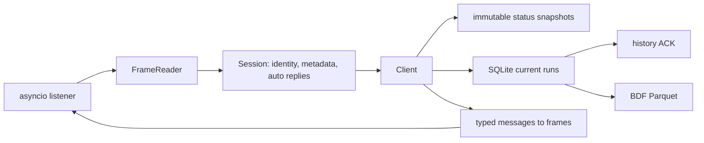

# Architecture

| Module | Role |
|---|---|
| `protocol.py` | Framing, the command catalogue, `Frame`, `FrameReader`. No I/O. |
| `messages.py` | One dataclass per payload (`from_payload` / `to_payload`). No I/O. |
| `steps.py` | Step-record bitmap grammar: `Step`, `encode_program`, `decode_program`. |
| `recipe.py` | Manufacturer XML → `Step` list, with the protected-subset rules. |
| `measurements.py` | Current scaling, work-type states, engineering units. |
| `alarms.py` | LogCode descriptions and alarm details packed into energy slots. |
| `session.py` | Per-connection state: identity, metadata assembly, Connect/SendInfo replies. |
| `client.py` | The public `Client`: socket, status cache, serialized exchanges, recording. |
| `storage.py`, `_bdf.py`, `_counters.py` | Durable runs, BDF export, capacity/energy totals. |
| `models.py`, `controller.py`, `errors.py` | Public value types and errors. |

The protocol modules are pure and typed (strict mypy covers the whole package). They are
importable for diagnostics, but only the names exported from `neware8` are a stable API.

## Exchanges

One operation runs at a time (`Client._operation`) and one request is outstanding at a time.
`_exchange` sends a frame and waits for the reply with the same command and form, from the
expected unit. A reply nobody asked for ends the session with `ProtocolError`. If a write's
reply does not arrive within 20 s, the connection is closed and `OperationUncertain` is
raised: writes are never retried, because the controller may have executed them.

The start sequence is written out in `Client._start_sequence` in the order the manufacturer
client uses; each reply is checked against its request (GUID, targets, fragment index)
before the next one is sent. Runs are registered in the Start reply hook, before any later
frame is read, so history of the new TestID cannot arrive before the run exists.

## Receiving

Frames are handled in arrival order in one task. Status uploads update the cache and
publish a new `StatusSnapshot` per frame; readers share snapshots instead of queueing
updates. History batches are committed to SQLite (WAL, `synchronous=FULL`) and only then
acknowledged. A connection that stays silent for `receive_timeout_s` is closed so that the
controller's next connection is accepted.

Memory is bounded by the status cache, one pending exchange, the metadata assembler (1 MiB)
and export row groups of 4096 records.

## Logging

`neware8` logs connections, state changes, controls and exports at INFO and exchanges at
DEBUG. Raw frames go to `neware8.wire` only when that logger is enabled explicitly.

The library performs no firmware, calibration or manufacturer installation operations.
